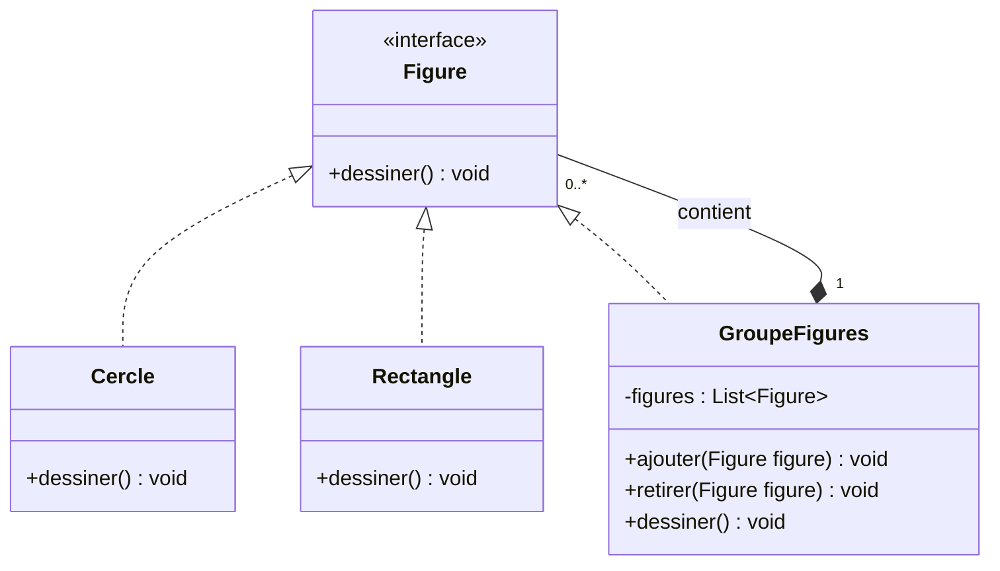
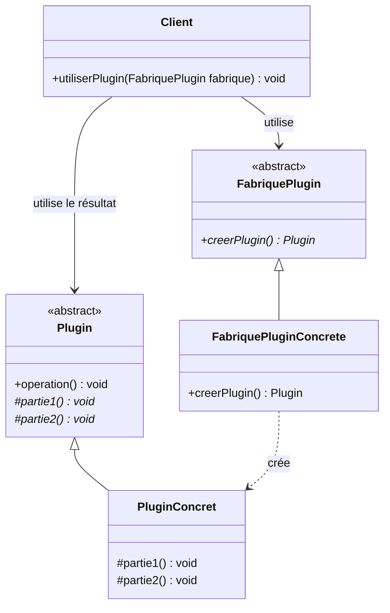
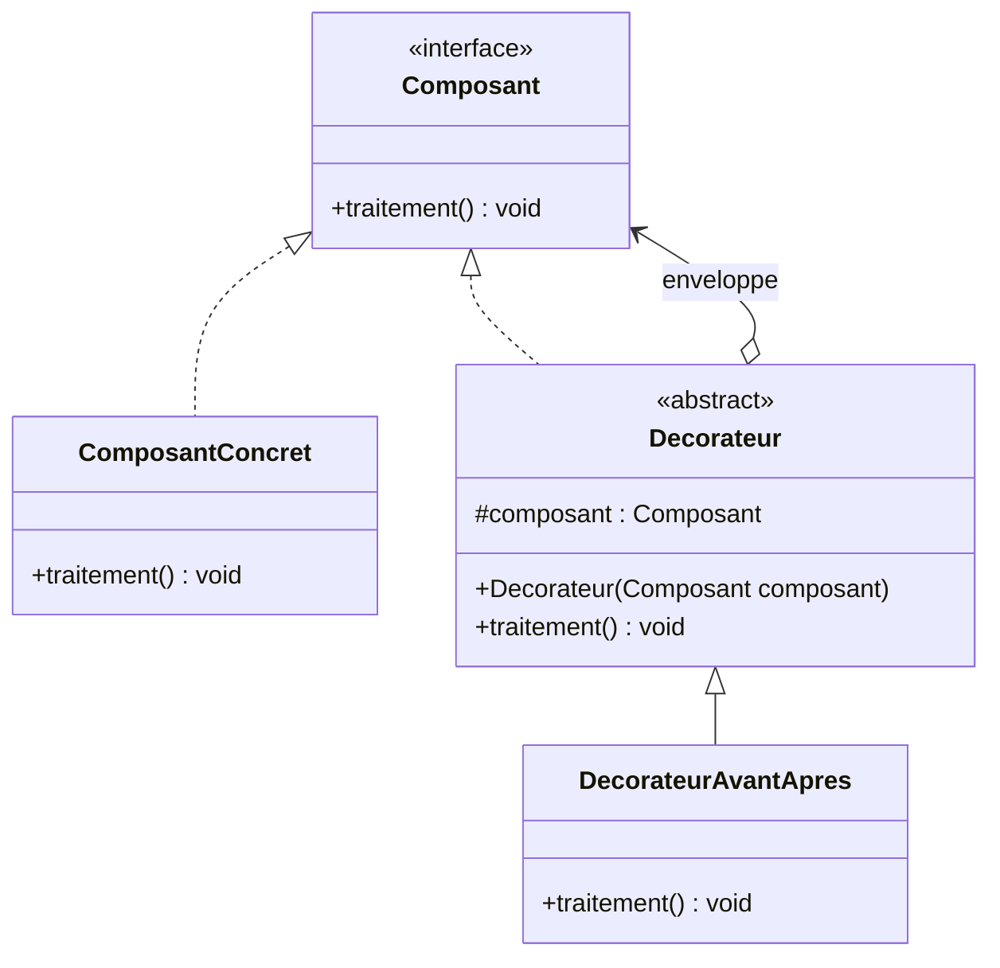
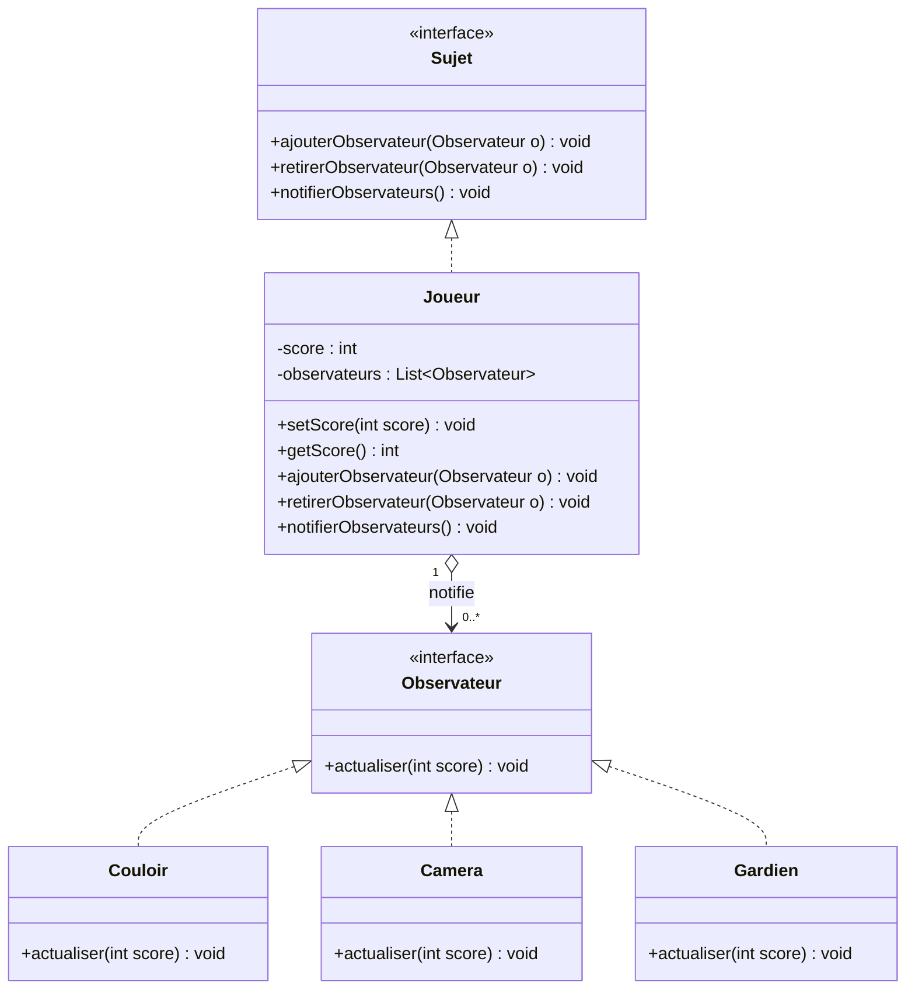

# Exercice 1 — Design Patterns

## Objectif

Identifier les Design Patterns adaptés à quatre situations et représenter leurs diagrammes de classes UML.

## Sommaire

1. [Composite — Figures géométriques](#1-composite--figures-géométriques)
2. [Template Method et Factory Method — Plugin](#2-template-method-et-factory-method--plugin)
3. [Decorator — Ajouter des responsabilités](#3-decorator--ajouter-des-responsabilités)
4. [Observer — Notification du changement de score](#4-observer--notification-du-changement-de-score)
5. [Récapitulatif](#récapitulatif)

---

## 1. Composite — Figures géométriques

### Énoncé

Une figure peut être un cercle, un rectangle ou un groupe de figures.

### Pattern utilisé : Composite

Le pattern **Composite** permet de traiter de manière uniforme des objets simples (`Cercle`, `Rectangle`) et des compositions d’objets (`GroupeFigures`). Un groupe peut contenir plusieurs figures, y compris d’autres groupes.

### Diagramme de classes

### Explication

- `Figure` définit l’interface commune.
- `Cercle` et `Rectangle` sont des feuilles (*Leaf*).
- `GroupeFigures` est le composite : il contient une collection de `Figure`.
- L’appel à `dessiner()` fonctionne aussi bien pour une figure individuelle que pour un groupe.

**Pourquoi Composite ?** Parce qu’on veut manipuler les objets simples et les groupes de figures via la même abstraction.

---

## 2. Template Method et Factory Method — Plugin

### Énoncé

Un plugin contient une opération qui définit le squelette d’un algorithme. Deux étapes (`partie1` et `partie2`) varient selon l’implémentation. Le client doit également pouvoir obtenir un plugin concret sans connaître sa classe d’implémentation.

### Patterns utilisés

- **Template Method** : la classe abstraite `Plugin` définit l’ordre général de l’algorithme dans `operation()`. Les sous-classes implémentent `partie1()` et `partie2()`.
- **Factory Method** : la création du plugin est déléguée à une méthode de fabrique. Le client dépend de l’abstraction `FabriquePlugin` et non de la classe concrète du plugin.

### Diagramme de classes

### Fonctionnement

1. Le client utilise une `FabriquePlugin`.
2. La fabrique concrète crée une instance de `PluginConcret` et la retourne comme un `Plugin`.
3. Le client appelle `operation()`.
4. `operation()` exécute le squelette commun et appelle les étapes spécialisées implémentées par le plugin concret.

**Pourquoi ces deux patterns ?** `Template Method` répond à la variation des étapes de l’algorithme. `Factory Method` répond au besoin de masquer la classe concrète lors de la création.

> Remarque : une fabrique simple peut également masquer la classe concrète. Le terme **Factory Method** désigne plus précisément une méthode de création redéfinie dans des sous-classes.

---

## 3. Decorator — Ajouter des responsabilités

### Énoncé

Un composant implémente une interface définissant `traitement()`. On veut ajouter des traitements avant et après l’exécution de cette méthode, sans modifier le code source du composant.

### Pattern utilisé : Decorator

Le pattern **Decorator** enveloppe un objet dans un autre objet qui respecte la même interface. Le décorateur peut ainsi ajouter des responsabilités avant et après l’appel à l’objet enveloppé.

### Diagramme de classes

### Fonctionnement

La méthode `traitement()` de `DecorateurAvantApres` :

1. exécute un traitement avant ;
2. appelle `composant.traitement()` ;
3. exécute un traitement après.

**Pourquoi Decorator ?** Il permet d’ajouter des responsabilités sans modifier la classe `ComposantConcret`. Le décorateur et le composant partagent la même interface.

---

## 4. Observer — Notification du changement de score

### Énoncé

La classe `Joueur` possède un score de type `int`. Les objets `Couloir`, `Camera` et `Gardien` doivent être informés à chaque changement de score, avec un couplage faible entre les classes.

### Pattern utilisé : Observer

Le pattern **Observer** établit une relation de type un-à-plusieurs : lorsqu’un sujet change d’état, il notifie ses observateurs inscrits.

### Diagramme de classes

### Fonctionnement

1. `Couloir`, `Camera` et `Gardien` s’inscrivent auprès du `Joueur`.
2. Quand `setScore()` détecte un changement de score, le joueur met à jour son état puis appelle `notifierObservateurs()`.
3. Chaque observateur reçoit le nouveau score via `actualiser(score)` et réagit selon son rôle.

**Pourquoi Observer ?** `Joueur` dépend de l’interface `Observateur`, et non directement des classes `Couloir`, `Camera` et `Gardien`. On peut donc ajouter de nouveaux observateurs sans modifier le joueur.

---

## Récapitulatif

| Situation | Pattern | Indice principal |
|---|---|---|
| Une figure est simple ou composée d’autres figures | **Composite** | Traiter uniformément les objets et les groupes |
| Squelette d’algorithme avec étapes variables | **Template Method** | Définir l’ordre des étapes et redéfinir certaines étapes |
| Création sans dépendre de la classe concrète | **Factory Method** | Déléguer la création à une fabrique polymorphe |
| Ajouter des traitements avant et après une opération | **Decorator** | Envelopper un objet sans modifier sa classe |
| Notifier plusieurs objets lors d’un changement d’état | **Observer** | Diffuser les changements aux observateurs inscrits |

# Exercice 2 — Framework de traitement d’images

## 1. Diagramme de classes

Le diagramme de classes présente l’architecture du framework et les relations entre les différentes classes et interfaces.

## 2. Implémentation Java

### 2.1. Interface `IFilter`

Cette interface définit le contrat commun aux différentes implémentations de filtrage d’images.

### 2.2. Classe `InversionFilter`

Cette classe implémente le filtrage par inversion des valeurs des pixels.

### 2.3. Classe `SeuilFilter`

Cette classe implémente un filtrage par seuillage, en transformant les valeurs des pixels selon un seuil défini.

### 2.4. Classe `ImplNonStandard`

Cette classe représente l’ancienne implémentation de filtrage, dont la signature de méthode est différente de celle définie par le framework.

### 2.5. Classe `FilterAdapter`

Cette classe adapte l’interface de `ImplNonStandard` à l’interface `IFilter`, permettant ainsi de réutiliser l’ancienne implémentation sans modifier son code source.

### 2.6. Classe `AbstractCompressor`

Cette classe abstraite définit le squelette de l’algorithme de compression et délègue les étapes variables aux sous-classes.

### 2.7. Classe `RLECompressor`

Cette classe implémente l’algorithme de compression RLE (*Run-Length Encoding*), qui représente les répétitions consécutives d’une même valeur par une valeur et son nombre d’occurrences.

### 2.8. Classe `ImageProcessor`

Cette classe constitue le point central du framework. Elle permet d’effectuer le filtrage et la compression des images tout en s’appuyant sur les abstractions définies.

### 2.9. Classe `Main`

Cette classe contient le programme principal permettant de tester le framework et de sélectionner les implémentations à utiliser.

**Première partie :**

## 3. Exécution de l’application

La capture suivante présente le résultat de l’exécution du programme et permet de vérifier le fonctionnement du framework.

## 4. Design Patterns utilisés

- **Strategy** : permet de changer dynamiquement l’algorithme de filtrage.
- **Adapter** : permet de réutiliser `ImplNonStandard` sans modifier son interface existante.
- **Template Method** : définit le squelette de l’algorithme de compression et laisse les sous-classes en implémenter les étapes variables.
- **Open/Closed Principle (OCP)** : permet d’étendre le framework avec de nouveaux filtres et compresseurs sans modifier son code existant.

## Conclusion

Ce framework illustre l’application des principes de conception orientée objet et des Design Patterns pour construire une solution extensible, réutilisable et facile à maintenir. La séparation entre les abstractions et les implémentations concrètes facilite l’ajout de nouveaux algorithmes de filtrage et de compression.
